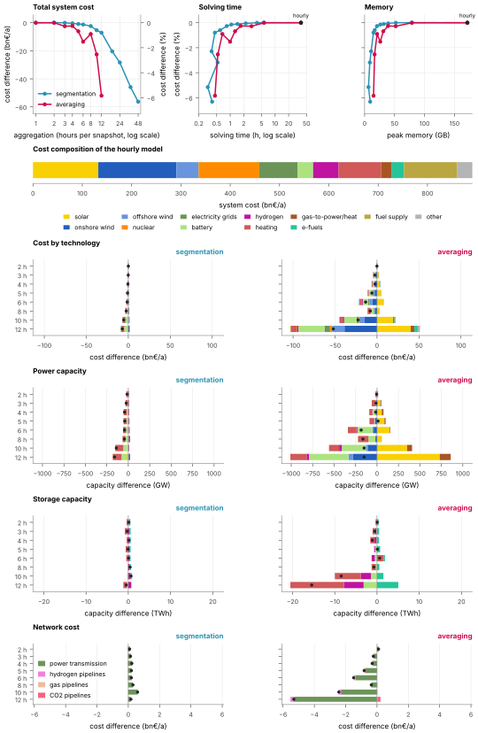

<!-- SPDX-FileCopyrightText: Contributors to PyPSA-Eur <https://github.com/pypsa/pypsa-eur> -->
<!-- SPDX-License-Identifier: CC-BY-4.0 -->

# Temporal aggregation

Solving PyPSA-Eur at hourly resolution takes long and needs much memory, so
the snapshots are often aggregated before optimisation. This page shows how
much accuracy that costs and how much effort it saves. In short, segmentation
keeps system costs and capacities close to the hourly model at a fraction of
the effort, down to about 1000 snapshots. Averaging does so only at moderate
resolutions.

## Setup

We solved a sector-coupled model for 2050 with 60 regions and the weather year
2013, once at hourly resolution and repeatedly with aggregated snapshots. Two
methods under `clustering: temporal:` are compared (see
[Model resolution](../design/resolution.md#temporal-resolution)):

- *Averaging* merges consecutive hours into blocks of equal length.
- *Segmentation* merges consecutive hours into blocks of variable length, which
  follow the changes in demand and renewable availability
  [@kotzurImpactDifferent2018; @hoffmannReviewTime2020]. The number of
  segments is chosen so that the average block length matches the averaging
  runs.



**Figure.** Effect of temporal aggregation relative to the hourly model. Top
row: total system cost against the hours per snapshot, solving time and peak
memory. Middle: cost composition of the hourly model. Bottom rows: differences
in cost, power capacity and storage energy capacity by technology; dots mark
the net difference. Power capacity counts generators and the input side of
conversion technologies. The bottom rows show resolutions up to 12 hours.
Costs and capacities exclude oil and methanol stores, which the solver did
not resolve precisely in the hourly model.

## Results

**Total cost.** Aggregation lowers total system cost because it smooths out
the peaks and ramps that the system has to balance. With segmentation, the
cost stays close to the hourly model up to about 8 hours per snapshot (about
1000 snapshots) and then falls faster; at 36 to 48 hours it is as far off as
averaging at 12 hours. With averaging, the cost stays close to the hourly
model up to about 4 hours per snapshot and then falls fast.

**Solving effort.** Solving time and peak memory fall steeply with coarser
resolution. The hourly model needs several times the time and twice the
memory of the 2-hourly models. For the same number of snapshots, both methods
need comparable effort, so the higher accuracy of segmentation comes at no
extra cost. Beyond 12 hours per snapshot, solving time stops falling, so
coarser resolutions lose accuracy without saving time.

**Technology mix.** The total cost hides shifts between technologies. At 10
and 12 hours, averaging replaces wind and batteries with solar and builds less
heat storage. Blocks of this length flatten the daily solar cycle, so solar
looks like steady supply and short-term storage loses its purpose.
Up to 12 hours, segmentation changes the mix only slightly; its largest
effect is less heating capacity. Beyond 12 hours, it shifts the mix in the
same direction as averaging: more solar, less wind and fewer batteries.

## Reproducibility

- **Code:** PyPSA-Eur at commit
  [`7bfe01f`](https://github.com/PyPSA/pypsa-eur/commit/7bfe01f8).
- **Configuration:**
  [`config.time-aggregation.yaml`](configs/config.time-aggregation.yaml) and
  [`scenarios.time-aggregation.yaml`](configs/scenarios.time-aggregation.yaml),
  on top of the default configuration.
- **Figure:** [`plot_temporal_aggregation.py`](scripts/plot_temporal_aggregation.py),
  run with
  `pixi run python doc/insights/scripts/plot_temporal_aggregation.py`.
- **Solver:** Gurobi 13.0.3, barrier method without crossover, 4 threads.
- **Hardware:** ZIB HTC cluster, three node types: AMD EPYC 9475F, Intel Xeon
  Gold 6338 and AMD EPYC 7542. Solving times are converted to one AMD EPYC
  9475F node with the hardware-independent work units that Gurobi reports.
- **Executed:** 30 October to 2 November 2026.

??? info "Configuration files"

    ```yaml title="config.time-aggregation.yaml"
    --8<-- "doc/insights/configs/config.time-aggregation.yaml"
    ```

    ```yaml title="scenarios.time-aggregation.yaml"
    --8<-- "doc/insights/configs/scenarios.time-aggregation.yaml"
    ```
